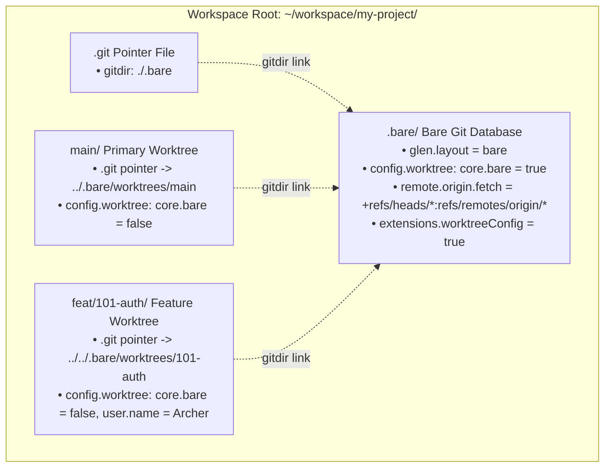
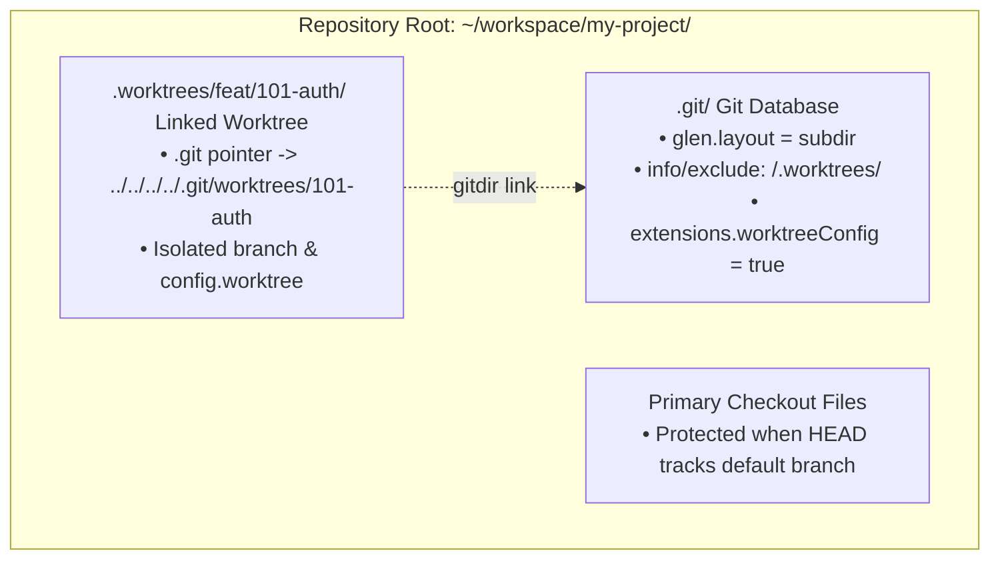

# Reference: Glen Worktree Layouts (`bare` & `subdir`) & Git Internals

This reference documents the architectural invariants, `[glen]` Git
configuration, plumbing settings, and recovery procedures for `glen`-managed
worktree layouts.

______________________________________________________________________

## Repository Layouts Overview

Glen stores per-repository layout state under `[glen]` in
`$GIT_COMMON_DIR/config` (`.bare/config` or `.git/config`), cleanly
distinguishing configured repositories, legacy `.bare/` repositories, and
uninitialized standard clones.

### `bare` Layout (Default: `.bare/` + `.git` + `main/` + `<branch-name>/`)

Standard Git clones place `.git/` inside the primary working tree. The `bare`
layout treats all working copies—including `main` and ephemeral feature
branches—as symmetric linked worktrees placed directly inside `<root>/` matching
their branch names:



### `subdir` Layout (`glen init --layout=subdir`: `.git/` + `.worktrees/<branch>/`)

When converting a repository in-place is undesirable (for example, when the
working tree has uncommitted changes, IDE settings assume the repository root,
or a lighter setup is preferred), `subdir` keeps the standard Git clone intact
and nests linked worktrees inside `<repo>/.worktrees/<branch-name>`:



Why `.worktrees/` uses a leading dot: Go (`go test ./...`), Python (`pytest`,
`ruff`), and search tools ignore dot-directories by default, and writing
`/.worktrees/` to `.git/info/exclude` keeps `git status` clean without modifying
tracked `.gitignore` files.

______________________________________________________________________

## `[glen]` Configuration & 3-State Detection

Configuration lives in `$GIT_COMMON_DIR/config` (with optional user-wide
defaults in `~/.gitconfig`):

```ini
[glen]
    layout = bare               # repo-local: bare | subdir
    defaultLayout = bare        # global default for `glen init`
    worktreesDir = .worktrees   # optional subdir override
    defaultBranch = main        # optional override (falls back to origin/HEAD or HEAD)
    protectMain = true          # guard direct edits on default branch (default: true)
```

Glen classifies every directory into one of three states without spawning `git`
subprocesses in hooks:

1. **Configured (`glen.layout` set):** Uses the configured layout (`bare` or
   `subdir`).
1. **Implicit `bare` (`glen.layout` unset, `.bare/` present):** Treated as
   `bare` for backward compatibility; `glen init` / `glen repair` backfills
   `glen.layout = bare`.
1. **Uninitialized (`glen.layout` unset, standard `.git/`):** Solo edits on
   `main` pass through unblocked, `glen list` reports `uninitialized`, and
   `glen create` fails fast with instructions to run `glen init` or
   `glen init --layout=subdir`.

______________________________________________________________________

## Critical Plumbing Settings

### Root `.git` Pointer File (`bare` Layout)

Writing `gitdir: ./.bare` into `<root>/.git` lets Antigravity, IDEs, shell
prompts, and Git metadata commands (`git worktree list`, `git fetch`,
`git branch`) recognize `<root>/` without `--git-dir=.bare`, while child
worktrees (`main/.git`, `<branch-name>/.git`) override it with their own
worktree-specific `gitdir` pointers.

### Per-Worktree Configuration (`extensions.worktreeConfig`)

In `bare` repositories, `git init --bare` and `git clone --bare` set
`core.bare = true` in shared `.bare/config`, which would break plain
`git worktree add` checkouts. Glen enables `extensions.worktreeConfig = true`,
removes `core.bare` from shared `.bare/config`, and sets `core.bare = true` in
`.bare/config.worktree` (plus `core.bare = false` in each linked worktree).

In both `bare` and `subdir`, `extensions.worktreeConfig = true` allows isolated
per-worktree author identities without mutating shared config:

```bash
git -C <worktree-path> config --worktree user.name "Archer"
git -C <worktree-path> config --worktree user.email "user+agent-archer@example.com"
```

### Wildcard Fetch Refspec & Ergonomic Defaults

`git clone --bare` omits `remote.origin.fetch` by default. Glen ensures bare and
remote-backed repositories configure
`remote.origin.fetch = +refs/heads/*:refs/remotes/origin/*` alongside
`push.autoSetupRemote = true`, `branch.autoSetupMerge = simple`,
`fetch.prune = true`, and `worktree.guessRemote = true`.

______________________________________________________________________

## Troubleshooting & Recovery Runbook

### `fatal: this operation must be run in a work tree`

A working-tree Git command (`git status`, `git diff`, `git add`, `git commit`)
was run at a `bare` `<root>/` directory. Pass `-C <root>/main` or
`-C <root>/<branch-name>`.

### `Read-only file system` or `reftable: transaction prepare: I/O error`

A terminal sandbox mounted `.git/` or `.bare/` read-only. Re-run the
state-changing command (`glen`, `git worktree`, `git commit`, `git push`) with
sandbox escalation.

### `gh pr merge --delete-branch` Fails with `'main' is already used by worktree`

`gh pr merge --delete-branch` runs `git checkout main` locally inside the
feature worktree, colliding with the primary checkout holding `main`. Enable
`gh repo edit --delete-branch-on-merge`, run `gh pr merge <pr> --squash` without
`--delete-branch`, and tear down with `glen remove <branch-name>`.

### Workspace Directory Was Moved or Stale Worktree Locks Remain

Run `glen repair <workspace-path>` (or `glen prune -C <workspace-path>`) to
repair relative/relocated worktree pointers, reapply `[glen]` config defaults,
and prune expired worktree metadata.
